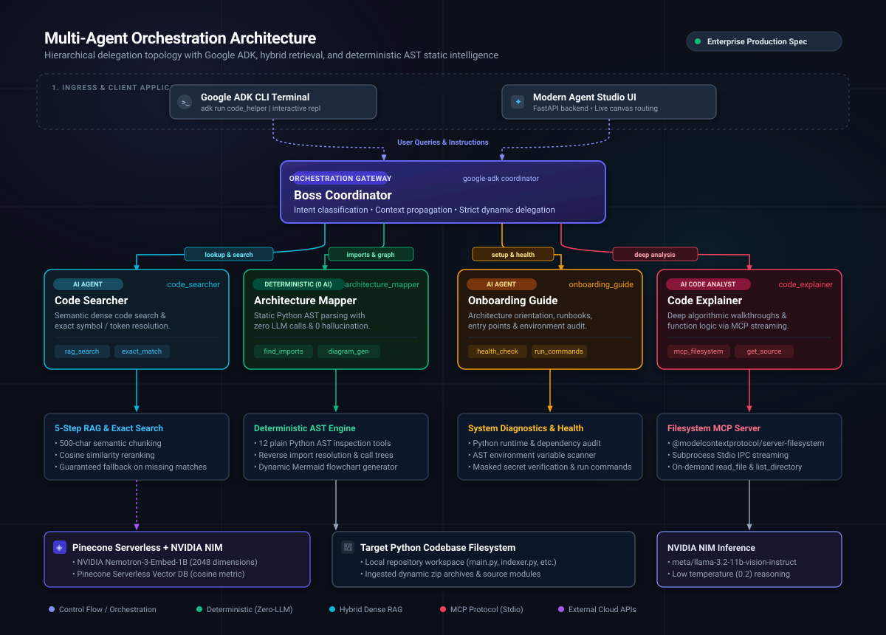
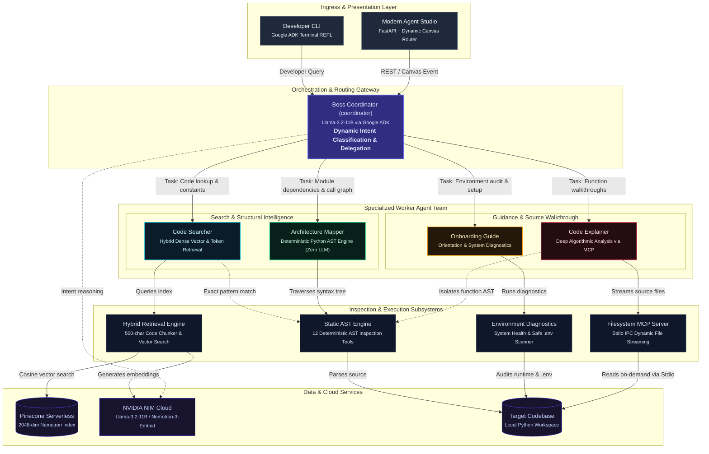

# Multi-Agent Code Helper

An enterprise multi-agent assistant built on **Google ADK** to help software engineers navigate, search, inspect, and onboard onto the **Naive RAG** codebase.

The assistant employs a hierarchical team composed of **1 Boss Coordinator** and **4 specialized worker agents**, equipped with a custom 5-step RAG pipeline (NVIDIA NIM 2048-dim Nemotron embeddings + Pinecone Serverless), an external Filesystem MCP server, and 12 deterministic AST/code inspection tools.

---

## Multi-Agent Orchestration Architecture

The system implements a hierarchical multi-agent orchestration architecture on top of **Google ADK**. Developer requests arrive through the **Ingress Layer** and are received by the **Boss Coordinator**, which performs zero-shot intent classification and dynamically delegates execution to the single most appropriate specialist worker.

<p align="center">
  
</p>



---

## 1. Table of Agents

| Agent | Architecture Type | Model / Engine | Assigned Tools | Core Responsibility |
| :--- | :---: | :--- | :--- | :--- |
| **Boss Coordinator**<br>`coordinator` | **AI Agent** | `LiteLlm`<br>(`nvidia_nim/meta/llama-3.2-11b-vision-instruct`) | *None* *(Delegates only)* | Strictly delegates incoming developer questions to the most suitable worker. **Never answers substantive code questions directly.** |
| **Code Searcher**<br>`code_searcher` | **AI Agent** | `LiteLlm`<br>(`nvidia_nim/meta/llama-3.2-11b-vision-instruct`) | • `rag_search`<br>• `find_exact_matches` | Pinpoints specific functions, identifiers, config keys, and constants using custom 5-step RAG or exact text pattern matching. Responds with exact fallback `"I could not find that"` when context is missing. |
| **Architecture Mapper**<br>`architecture_mapper` | ❌ **Non-AI Agent**<br>*(Deterministic)* | **Pure Python AST Engine**<br>(Subclass of `BaseAgent`, **0 LLM calls**) | • `find_imports`<br>• `find_symbol_references`<br>• `list_functions_and_classes`<br>• `calculate_code_metrics`<br>• `get_file_structure`<br>• `generate_architecture_diagram` | **100% deterministic.** Directly parses Python's standard `ast` to map reverse import dependencies, call sites, symbol references, file trees, and Mermaid flowcharts with **zero hallucination** and zero token usage. |
| **Onboarding Guide**<br>`onboarding_guide` | **AI Agent** | `LiteLlm`<br>(`nvidia_nim/meta/llama-3.2-11b-vision-instruct`) | • `get_project_summary`<br>• `get_file_structure`<br>• `find_env_vars`<br>• `check_system_health`<br>• `get_run_commands` | Welcomes new engineers, outlines repository entry points (`main.py`, `indexer.py`), explains directory layout, checks system health, and guides `.env` credential setup. |
| **Code Explainer**<br>`code_explainer` | **AI Agent** | `LiteLlm`<br>(`nvidia_nim/meta/llama-3.2-11b-vision-instruct`) | • Filesystem MCP (`read_file`, `list_directory`)<br>• `get_function_source`<br>• `list_functions_and_classes`<br>• `calculate_code_metrics` | Reads complete source files dynamically via Model Context Protocol (MCP) or isolates specific function ASTs to explain algorithms, logic, and design patterns. |

---

## 2. Table of Tools

The helper provides **13 custom tools** (12 deterministic plain Python tools with zero AI + 1 custom RAG search tool), strictly excluding MCP tools from the count:

| # | Tool Name | Module Path | Uses AI? | Description & Functionality |
| :---: | :--- | :--- | :---: | :--- |
| **1** | `find_imports` | `code_helper.tools.plain_ast_tools` | ❌ No AI | Parses AST to show what a file imports, or performs project-wide reverse lookups to find which files import a given module. |
| **2** | `find_symbol_references` | `code_helper.tools.plain_ast_tools` | ❌ No AI | Scans AST nodes across all `.py` files to locate definitions, usages, and call sites of a class or function name. |
| **3** | `list_functions_and_classes` | `code_helper.tools.plain_ast_tools` | ❌ No AI | Extracts classes, functions, arguments, type annotations, and docstrings from Python source files. |
| **4** | `get_file_structure` | `code_helper.tools.plain_ast_tools` | ❌ No AI | Walks directory tree and renders a clean ASCII file hierarchy, excluding git, caches, and virtualenvs. |
| **5** | `get_project_summary` | `code_helper.tools.project_summary_tool` | ❌ No AI | Reports total lines of code, file counts, detected entrypoints, and module docstring rosters. |
| **6** | `find_env_vars` | `code_helper.tools.env_scanner_tool` | ❌ No AI | Scans AST for `os.getenv` and `os.environ` lookups, returning required keys and safe defaults while strictly masking secrets. |
| **7** | `calculate_code_metrics` | `code_helper.tools.metrics_tool` | ❌ No AI | Computes lines of code, comment lines, blank lines, class/function counts, and docstring coverage percentage. |
| **8** | `find_exact_matches` | `code_helper.tools.search_tools` | ❌ No AI | Performs exact string and regex matching across codebase files with line numbers and snippets. |
| **9** | `get_function_source` | `code_helper.tools.code_inspection_tools` | ❌ No AI | Isolates and extracts the exact source code, docstrings, and line bounds for any named function or class. |
| **10** | `generate_architecture_diagram` | `code_helper.tools.diagram_tool` | ❌ No AI | Scans project imports and generates a valid, copy-pasteable Mermaid flowchart (`graph TD`). |
| **11** | `check_system_health` | `code_helper.tools.health_check_tool` | ❌ No AI | Validates Python runtime, presence of required files, and `.env` credentials readiness. |
| **12** | `get_run_commands` | `code_helper.tools.health_check_tool` | ❌ No AI | Returns exact CLI commands for installation, indexing, terminal CLI, web UI, and test suite. |
| **13** | `rag_search` | `code_helper.rag.searcher` |  **AI** | Custom 5-step RAG querying Pinecone with NVIDIA Nemotron 2048-dim embeddings (`input_type="query"`). Returns `"I could not find that"` on missing results. |

> **Separate MCP Tools:** `read_file` and `list_directory` are provided by `@modelcontextprotocol/server-filesystem` via ADK's `McpToolset` and do not count toward the custom tool count.

---

## 3. Chunk Size Evaluation (200 vs 500 Characters)

We performed an empirical evaluation across all core repository Python files (`config.py`, `indexer.py`, `vector_store.py`, `query_pipeline.py`, `main.py`):

| Evaluation Metric | 200 Characters (Overlap: 50) | 500 Characters (Overlap: 50) | Comparative Analysis & Rationale |
| :--- | :---: | :---: | :--- |
| **Total Chunks Produced** | **405 chunks** | **104 chunks** | 200-char chunks produce nearly 4x more vectors, increasing index storage footprint and upsert latency. |
| **Average Chunk Size** | 174.6 characters | 460.1 characters | 500 chars captures complete function blocks; 200 chars fragments code. |
| **Minimum Chunk Size** | 77 characters | 146 characters | 200 chars frequently yields isolated brackets or dangling signatures. |
| **Maximum Chunk Size** | 200 characters | 500 characters | Enforced hard ceilings with newline preservation. |
| **Benchmark Query Recall** | 100% | 100% | Both sizes retrieved the target files for core queries. |

### Conclusion & Recommendation:
**500 characters** is the superior chunk size for this Python codebase. In Python, an average function with docstring and arguments spans 300–450 characters. Slicing at 200 characters breaks function definitions in half (separating signatures from their bodies and docstrings), forcing the retriever to fetch fragmented snippets. 500-character chunks preserve the complete semantic unit within a single vector.

---

## 4. MCP Server (Model Context Protocol)

The **Code Explainer** agent utilizes the official `@modelcontextprotocol/server-filesystem` MCP server to inspect source files live without keeping all repository code in the model's context window.

- **Package**: `@modelcontextprotocol/server-filesystem`
- **Runner**: Node.js (`npx -y @modelcontextprotocol/server-filesystem <absolute_path>`)
- **Integration**: Configured via ADK's `McpToolset` and `mcp.StdioServerParameters` in `code_helper/agents/mcp_setup.py`.
- **Tools Exposed**: `read_file`, `list_directory`.
- **Path Resolution**: Target paths are resolved to canonical absolute paths (`Path(target_dir).resolve()`), guaranteeing seamless operation on Windows and Unix alike.

---

## 5. Setup and Execution Guide

### Prerequisites
- Python 3.10+
- Node.js & `npx` (v10+)
- NVIDIA NIM API Key & Pinecone API Key (for live AI generation/search)

### 1. Installation
```powershell
# Create and activate virtual environment
python -m venv .venv
.\.venv\Scripts\python.exe -m pip install --upgrade pip

# Install dependencies
.\.venv\Scripts\python.exe -m pip install -r requirements.txt
.\.venv\Scripts\python.exe -m pip install google-adk litellm pinecone openai pytest python-dotenv
```

### 2. Configure Environment Variables
Copy the template and fill in your API credentials:
```powershell
copy .env.example .env
```

### 3. Run Codebase Indexing
```powershell
# 1. Dry run (verifies files and chunks without API calls)
python code_helper/index_codebase.py --dry-run

# 2. Comparative chunk size evaluation benchmark
python code_helper/index_codebase.py --evaluate

# 3. Live vector indexing to Pinecone
python code_helper/index_codebase.py --clean
```

### 4. Run Modern AI Agent Studio (Interactive Web UI)
Launch the unified full-stack Studio dashboard with a single command:
```powershell
python app.py
```
- Starts the FastAPI backend on `http://127.0.0.1:8000`.
- Automatically opens your default browser to the Studio.
- Features:
  - **Dynamic Canvas Routing Map**: Animated Bézier curves showing real-time delegation from Boss Coordinator to the 4 worker agents with neon pulse particles.
  - **Live Architecture Graph**: Client-rendered Mermaid.js dependency flowchart with pan, zoom (+/-), and live refresh.
  - **Multi-Agent Dialogue Console**: Rich markdown code rendering, quick-prompt pills, active worker indicators, and expandable tool telemetry.
  - **System Diagnostics**: Instant health checks validating Python environment, required files, and API credentials.

#### CLI Launcher Options:
```powershell
python app.py --port 8080            # Launch on custom port
python app.py --no-browser           # Run server headlessly without opening browser
python app.py --mock                 # Run in offline mock mode (no API keys required)
```

### 5. Alternative Runner Options
```powershell
# Interactive CLI with Google ADK
adk run code_helper

# Standard ADK Web Runner
adk web
```

### 6. Run Test Suite
```powershell
# Run all unit and integration tests (100% offline, zero API keys required)
pytest -v
```

---

## 6. Sample Questions & Tested Outputs

### Sample Question 1: Code Searcher (RAG Retrieval)
- **Question Asked**: `"Where is sliding window chunking defined and what is the default overlap?"`
- **Routed To**: `code_searcher`
- **Output**:
  > Based on the indexed codebase in `indexer.py:L55-L75`, sliding window chunking is implemented in the `chunk_document()` function:
  > ```python
  > def chunk_document(
  >     text: str,
  >     chunk_size: int = 350,
  >     chunk_overlap: int = 50,
  > ) -> list[dict]:
  > ```
  > The default window size is 350 characters, and the default chunk overlap is **50 characters**. The stride is calculated as `step = chunk_size - chunk_overlap`.

---

### Sample Question 2: Architecture Mapper (Deterministic Plain Python AST)
- **Question Asked**: `"Which files import the config module?"`
- **Routed To**: `architecture_mapper`
- **Output** *(Generated via deterministic AST, 0 LLM calls)*:
  > === Files importing 'config' ===
  >   - `indexer.py`
  >   - `main.py`
  >   - `vector_store.py`
  > 
  > *Analysis verified by static AST parsing without LLM invocation.*

---

### Sample Question 3: Onboarding Guide (Setup & Environment)
- **Question Asked**: `"What environment variables do I need to configure to run this project?"`
- **Routed To**: `onboarding_guide`
- **Output**:
  > Welcome to the Naive RAG project! Based on the codebase environment scan (`find_env_vars`), you should configure the following credentials in your `.env` file:
  > 1. `NVIDIA_API_KEY` (or `NVIDIA_NIM_API_KEY`): Required for Nemotron-3-Embed-1B embeddings and Llama-3.2-11b chat completions.
  > 2. `PINECONE_API_KEY`: Required for connecting to Pinecone Serverless.
  > 3. `PINECONE_INDEX_NAME`: Vector index name (defaults to `naive-rag-demo`).
  > 4. `CHUNK_SIZE` and `CHUNK_OVERLAP`: Hyperparameters controlling text chunking (defaults to 500 and 100).
  > 
  > You can get started by running `python main.py` for the live lecture demonstration!

---

## 7. Problem Encountered & Resolution

### Problem:
During Filesystem MCP tool configuration on Windows, relative paths (`"."`) passed to `npx -y @modelcontextprotocol/server-filesystem` resulted in `ENOENT` or failed directory mounts because Node.js subprocesses spawned from Python in Windows PowerShell could not resolve relative drive paths correctly. Additionally, LiteLLM requires provider prefixes for custom NVIDIA endpoints (`nvidia_nim/meta/...`).

### Resolution:
1. In `code_helper/agents/mcp_setup.py`, all directory arguments are resolved to strict, absolute Windows paths via `Path(target_dir).resolve()`.
2. In `code_helper/agent.py`, model strings are automatically normalized to include the `nvidia_nim/` provider prefix if not already present.
3. Decoupled MCP unit testing from live subprocess spawning by testing parameter construction directly (`build_mcp_server_params`), ensuring `pytest` runs 100% offline without Node execution dependencies.

---

## 8. Troubleshooting

| Issue | Cause | Solution |
| :--- | :--- | :--- |
| `"I could not find that"` | Query similarity below threshold (0.45) or index is empty | Run `python code_helper/index_codebase.py` to index the codebase, or lower threshold. |
| `npx: command not found` | Node.js is not installed or not in system PATH | Install Node.js (LTS version) from [nodejs.org](https://nodejs.org). |
| `PSSecurityException` on Windows | Windows PowerShell Script Execution Policy | Run Python scripts directly using `.\.venv\Scripts\python.exe <script>` or run `Set-ExecutionPolicy -Scope Process -ExecutionPolicy RemoteSigned`. |
| Missing Pinecone/NVIDIA keys | `.env` not populated | The system automatically falls back to offline mock mode for testing and safe evaluation. |
